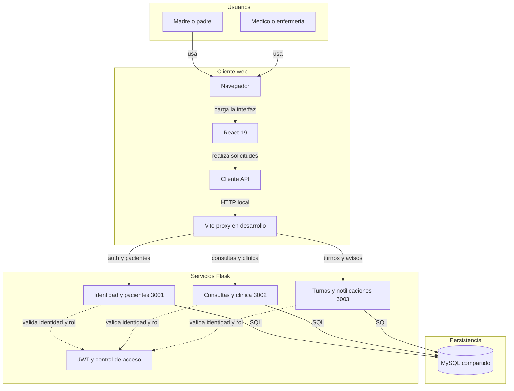
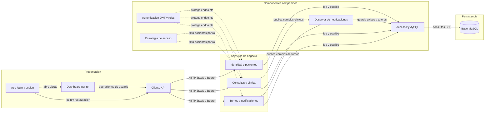

# Architecture Diagram

PediaCare+ es una aplicacion web para gestionar pacientes, consultas, medicacion, vacunas, turnos y notificaciones. El frontend React consume tres servicios Flask que comparten una base MySQL.

## Application Architecture

<!-- mermaid-checked: no \n, no em-dash/en-dash, no {} in labels, subgraphs are id["label"], arrows are -->|"label"|, all subgraphs closed by end, ids unique -->

### Technology Stack Summary

| Layer | Technology | Version | Purpose |
|---|---|---|---|
| Interfaz web | React | `^19.2.8` | Vistas para familias, medicos y enfermeria |
| Desarrollo y proxy | Vite | `^8.3.6` | Sirve la web y enruta `/api` a cada servicio |
| Cliente API | JavaScript Fetch | Navegador | Envia solicitudes HTTP y tokens Bearer |
| Servicios API | Python y Flask | Flask `>=3.1,<4` | Autenticacion, pacientes, clinica y coordinacion |
| Persistencia | MySQL | Compatible con esquema SQL | Guarda usuarios y datos clinicos compartidos |

### Data Storage & External Services

Los tres servicios acceden a la misma base MySQL mediante PyMySQL; no se comunican entre si por HTTP. La base guarda cuentas, pacientes y tutores, historias y consultas, medicacion y recordatorios, vacunas, turnos y notificaciones. No se identifican integraciones externas de correo, SMS, almacenamiento o mensajeria en el runtime actual; las notificaciones se guardan en la base para la aplicacion.

### Key Architectural Decisions

- Los servicios Flask se separan por responsabilidad y comparten el esquema MySQL y el contrato `/api`.
- Los servicios validan JWT, rol y estado de cuenta; el acceso a pacientes aplica una estrategia segun el rol.
- Los eventos de cambios clinicos y turnos persisten notificaciones para los tutores dentro de la transaccion.

## Component Relationships

<!-- mermaid-checked: no \n, no em-dash/en-dash, no {} in labels, subgraphs are id["label"], arrows are -->|"label"|, all subgraphs closed by end, ids unique -->

### Component Inventory

| Component | Layer | Type | Responsibility |
|---|---|---|---|
| `App.jsx` | Presentacion | Componente React | Login, restauracion de sesion y acceso demo por rol |
| `AuthenticatedDashboard.jsx` | Presentacion | Componente React | Muestra vistas y operaciones segun el rol |
| `services/api.js` | Presentacion | Cliente HTTP | Centraliza solicitudes, JSON, tokens y errores |
| Servicio de identidad | Negocio | API Flask | Registro, login, cuenta actual, pacientes y tutores |
| Servicio clinico | Negocio | API Flask | Consultas, medicacion, recordatorios y vacunas |
| Servicio de coordinacion | Negocio | API Flask | Turnos, notificaciones, preferencias y salud |
| `common/security.py` | Compartido | Seguridad | Emite y valida JWT; comprueba cuenta activa y permisos |
| `common/access.py` | Compartido | Estrategia | Aplica el alcance de pacientes segun el rol |
| `common/events.py` | Compartido | Observer | Persiste avisos de cambios para tutores |
| `common/database.py` | Acceso a datos | Adaptador PyMySQL | Conexiones, consultas y transacciones con MySQL |
| `pedia_care` | Persistencia | Base relacional | Almacena usuarios y registros administrativos y clinicos |